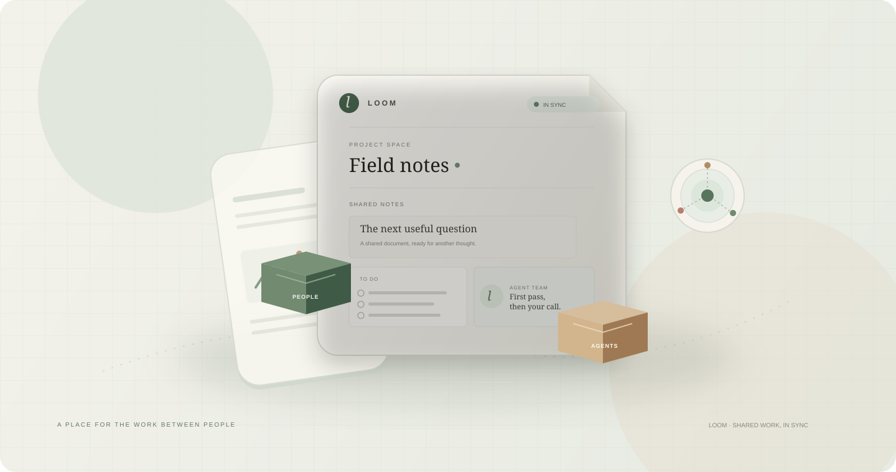
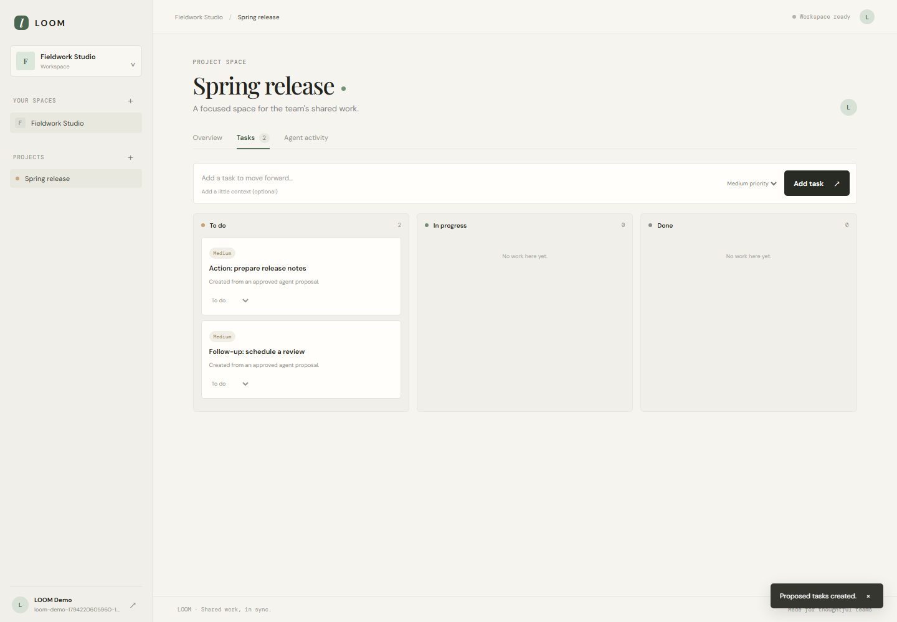
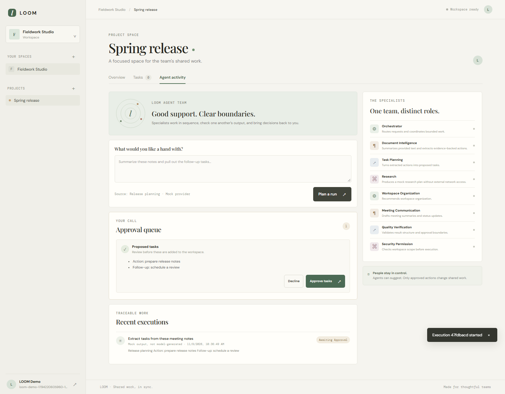
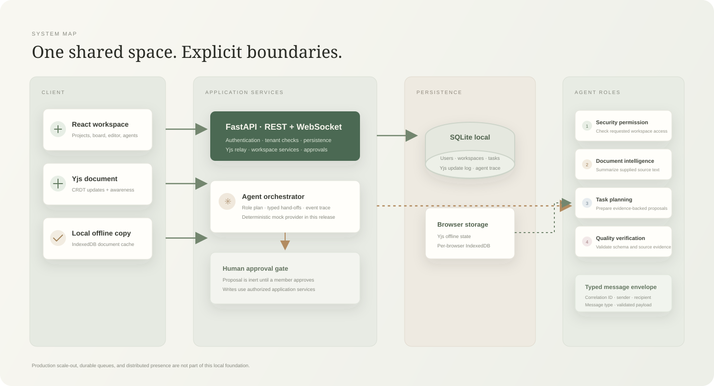
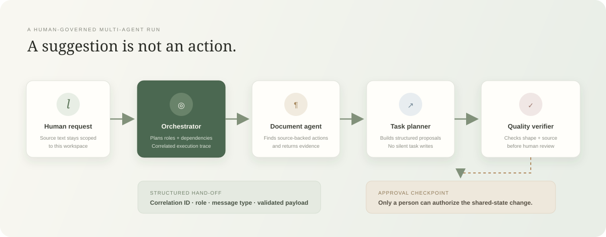

<div align="center">
  
</div>

<div align="center">
  <h1>LOOM</h1>
  <p><strong>Shared work, in sync.</strong></p>
  <p>A collaborative workspace for documents, project work, and human-governed AI assistance.</p>
  <p>
    
    
    
    
  </p>
</div>

<br>

> **Start the whole app with one command.** Run `powershell -ExecutionPolicy Bypass -File .\run.ps1` from the project folder. LOOM prepares missing dependencies, starts the API and frontend together, waits for both to be healthy, and opens the app in your browser.

<div align="center">
  <a href="docs/assets/loom-demo.webm"><strong>▶ Watch the recorded workspace demo</strong></a>
  &nbsp;·&nbsp;
  <a href="docs/assets/workspace-preview.png">Workspace screenshot</a>
  &nbsp;·&nbsp;
  <a href="docs/assets/agent-approval.png">Agent approval screenshot</a>
</div>

<video src="docs/assets/loom-demo.webm" controls muted playsinline width="100%">
  <a href="docs/assets/loom-demo.webm">Play the LOOM workflow recording.</a>
</video>

## What LOOM does

LOOM brings a team's shared work into one focused space:

- **Workspace and project spaces** with member-scoped access to projects and their content.
- **Shared documents** edited with Yjs CRDT updates over authenticated WebSockets.
- **Offline-friendly editing** with browser IndexedDB persistence and Yjs update merging on reconnect.
- **Tasks and a status board** connected to project work.
- **A traceable multi-agent workflow** with specialist responsibilities, structured hand-offs, validation, and human approval before proposed tasks are created.
- **An intentionally deterministic local provider**, so the core workflow can run without an API key. Its output is clearly marked as mock output, not model-generated intelligence.

The collaboration system works independently of the AI layer. Agents propose; application services authorize; people approve consequential changes.

## In the workspace

The images below are captured from the running frontend using the included Playwright recording workflow. The isometric artwork and diagrams are original LOOM illustrations.

<div align="center">
  
  <p><em>Project board after a human approves an agent-proposed follow-up task.</em></p>
</div>

<div align="center">
  
  <p><em>Agent activity and the approval checkpoint before any shared task is created.</em></p>
</div>

## How it fits together

<div align="center">
  
</div>

### A proposal-first agent flow

<div align="center">
  
</div>

Eight roles are registered: orchestrator, security and permission, document intelligence, task planning, research, workspace organization, meeting and communication, and quality verification. Request planning selects relevant handlers. Each execution records role events and validated, correlated messages.

The current provider is a deterministic implementation for local development. The specialist roles are real, independently defined handlers, but they are **not independent LLM instances**. Research does not call the internet. This is a working foundation, not a claim that the full planned AI platform is finished.

## Run the entire app with one command

### Requirements

- Windows 10 or 11 with PowerShell.
- Python 3.11 or newer.
- Node.js 22 or newer and npm.
- Internet access on first run to install dependencies.

Open PowerShell in the LOOM project folder and run:

```powershell
powershell -ExecutionPolicy Bypass -File .\run.ps1
```

That's the complete startup command. On first run, the launcher creates `backend\.venv` and installs the backend dependencies, installs the locked frontend dependencies if needed, then starts both services and opens:

- **LOOM:** <http://127.0.0.1:5173>
- **API documentation:** <http://127.0.0.1:8000/docs>
- **Health check:** <http://127.0.0.1:8000/health>

The launcher keeps the services attached to the same PowerShell session. Press **Ctrl+C** there to stop both. Logs are written to `.loom\logs\`. The local SQLite database is stored at `backend\loom.db` and is ignored by Git.

To start both services without opening a browser:

```powershell
powershell -ExecutionPolicy Bypass -File .\run.ps1 -NoBrowser
```

The launcher checks Python and Node versions, refuses to take ports 8000 or 5173 when already in use, and reports startup failures with the relevant log paths. It does not silently launch an alternate port.

### First visit

1. Register with a name, email, and password of at least 10 characters.
2. Create a workspace, then a project.
3. Create a shared document and open it in a second browser tab to see the presence indicator and live Yjs synchronization.
4. Write meeting notes with a line such as `Action: prepare release notes`.
5. Choose **Ask agents**, request task extraction, and review the proposal in the approval queue.
6. Approve the proposal to create the task, or decline it to leave shared state unchanged.

## Developer commands

The one-command launcher is the recommended way to run the product. If you need an individual development command:

```powershell
Set-Location E:\Desktop\Projects\Loom\backend
.\.venv\Scripts\python.exe -m pytest
```

```powershell
Set-Location E:\Desktop\Projects\Loom\frontend
npm run build
```

Record a fresh, real browser walkthrough while LOOM is running:

```powershell
Set-Location E:\Desktop\Projects\Loom\frontend
npm run record:demo
```

The recording script creates a temporary account, performs the workspace, document, agent approval, and task-board flow in Chromium, then saves updated screenshots and a WebM recording under `docs\assets\`. Chromium can be installed for Playwright with `npx playwright install chromium`.

## Realtime and agent behavior

### Collaborative documents

The editor stores content in a Yjs `Y.Text` shared type. Clients exchange base64-encoded CRDT updates through the document WebSocket; the API appends updates to the document update log and relays them to connected clients. The browser also persists the Yjs document in IndexedDB for local recovery and reconnect synchronization.

This version uses an in-process WebSocket room manager. Presence is ephemeral and does not span API processes. The update log has no compaction or snapshot replay optimization yet. The editor is a collaborative plain-text surface, not a rich-text editor.

### Agent safety boundary

Agent outputs are mock data and are displayed as such. Workspace membership is checked on the server. Agent-proposed tasks are persisted for review and are only created after a workspace member approves them through the backend approval endpoint. No agent has shell, filesystem, or unrestricted network tools.

## API at a glance

Routes are versioned under `/api/v1`. Registration, login, and `/health` are public; other HTTP API calls require a bearer access token.

| Area | Implemented routes |
|---|---|
| Auth | `POST /auth/register`, `POST /auth/login`, `GET /auth/me` |
| Workspaces and projects | `GET/POST /workspaces`, `GET/POST /workspaces/{id}/projects` |
| Documents | `GET/POST /projects/{id}/documents`, `GET /documents/{id}`, `GET /documents/{id}/history`, `POST /documents/{id}/versions` |
| Tasks | `GET/POST /projects/{id}/tasks`, `GET /tasks/{id}`, `PATCH /tasks/{id}` |
| Comments | `GET/POST /documents/{id}/comments` |
| Agents and approvals | `GET /agents`, `POST /agent-executions`, `GET /agent-executions`, `GET /agent-executions/{id}`, `POST /agent-executions/{id}/cancel`, `GET /agent-approvals`, `POST /agent-approvals/{id}` |
| Document sync | `WS /documents/{id}/sync?token=...` |

The live OpenAPI schema at <http://127.0.0.1:8000/openapi.json> describes the request and response models currently implemented.

## Configuration and deployment

Local development defaults to SQLite and a development-only signing key. Never reuse that key outside your machine. Configure `SECRET_KEY`, `DATABASE_URL`, `CORS_ORIGINS`, and `ACCESS_TOKEN_MINUTES` through environment variables for a deployed API. The frontend accepts `VITE_API_URL` at build time.

Docker Compose is an optional local alternative. It needs Docker Desktop and a generated signing key:

```powershell
$bytes = New-Object byte[] 48
[Security.Cryptography.RandomNumberGenerator]::Create().GetBytes($bytes)
$env:SECRET_KEY = [Convert]::ToBase64String($bytes)
docker compose up --build
```

Compose serves the web UI at <http://localhost:5173> and the API at <http://localhost:8000>. It uses a persistent SQLite volume for local evaluation, not a production database setup.

## Security and known limitations

- Passwords are hashed and bearer tokens expire. Workspace membership checks are enforced by the API, not the UI.
- WebSocket connections are authenticated and checked against workspace membership.
- Browser access tokens currently use `localStorage`; a successful XSS could expose them. A restrictive Content Security Policy is not configured.
- The WebSocket token currently travels in the query string. Replace it with a short-lived one-time connection ticket and redact query strings in proxy logs before deployment.
- Invitations, workspace role administration, uploads, notifications, threaded comments, document restore, database migrations, rate limiting, and fine-grained document permissions are not yet implemented.
- Agent jobs use in-process asyncio tasks and are not durable across service restarts. External LLM providers, distributed workers, multi-process collaboration, and production performance measurements are not included.
- Use HTTPS/WSS, a strong secret, a production database, secure deployment configuration, and durable background workers before exposing the service publicly.

## Project layout

```text
backend/
  app/                 FastAPI API, data model, auth, and agent orchestration
  tests/               Backend integration and access-control tests
frontend/
  src/                 React workspace interface and Yjs editor
  scripts/             Playwright end-to-end demo recorder
docs/
  assets/              Original diagrams and captured app demonstrations
  architecture.md      Trust boundaries and production gaps
run.ps1                One-command Windows launcher for both services
```

## Credits

The README structure takes inspiration from the [Aeon multi-agent RAG orchestration engine](https://github.com/Yog-esh06/Aeon-multi-agent-RAG-orchestration-engine), especially its demo-first gallery, feature narrative, and architecture presentation. LOOM's copy, diagrams, and visual direction are original to this project.

Created by **Yogesh R. Mehta** · [GitHub](https://github.com/Yog-esh06) · [LinkedIn](https://www.linkedin.com/in/yog-esh-06/)
